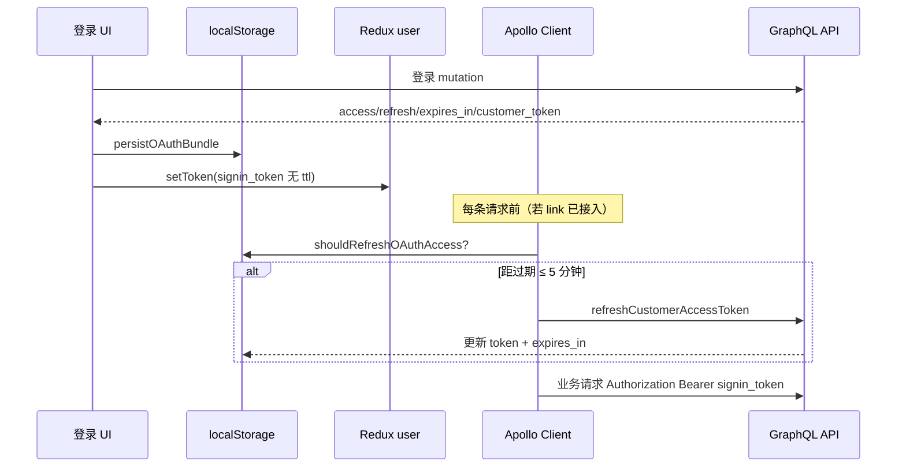

# OAuth 会话 / 登录刷新问题 — 本地修改说明

> 分支上下文：`perf/refresh-token-2` 及相关本地改动  
> 最后整理：2026-05-26

本文档记录 **本地所有相关修改点**、**当前会话逻辑**，以及 **各自解决的问题**。便于 Code Review、交接与后续补齐（如 refresh 失败自动登出、Apollo links 全量 alias）。

---

## 一、解决的问题（总览）

| 现象 | 根因（简要） | 修复方向 |
|------|----------------|----------|
| 邮箱/手机登录后停在 `/sign-in` 或首页，像无限刷新 | OAuth `signin_token` **无 BrowserPersistence TTL** → `scheduleSignOut` 把过期时间算成 0 → 立刻 `signOut`；部分路径还有 `history.go(0)` | 中间件跳过无 ttl；禁止 `history.go(0)`；`shouldIgnoreAutoSignOut` |
| 登录后 `signin_token` 带 `ttl: 3600`，约 1 小时本地失效 |  stock `setToken` 写死 `storage.setItem(..., 3600)` | `setToken` 不写 TTL |
| 登录成功但 refresh  seemingly 未用 | 需 `expires_in` + Apollo 链上的 refresh link；override 需 webpack alias 生效 | `customerSessionToken.js` + `refreshTokenLink` |
| 全页闪「MENGAMBIL DATA…」 | `IntlProvider` 的 `key={language}` 导致整树 remount | 去掉 `key`，保留 `locale` |
| 登录后重复 `history.replace` / push | `useSignInPage` 在 `isSignedIn` 抖动时重复跳转 | `useRef` 只 redirect 一次 |
| 渲染期 `history.replace` 与路由打架 | `newMyAccount` / `customerAccount` 在 render 里跳转 | 改为 `useEffect` |
| 退出无效 / `userContext is not defined` | 解构只剩 `[{ isSignedIn }]` 却仍用 `userContext[1]` | `signOut({ explicit: true })` + 正确解构 |
| 登录后 MiniCart 报错 | `miniCartData.cart` 为 null 仍读 `.items` | `cart?.items` |
| `src/overrides/peregrine/*` 不生效 | `@magento/peregrine/lib/...` 默认解析到 `node_modules` | `webpack.config.js` 显式 alias |

---

## 二、当前会话逻辑（OAuth + Magento）

### 2.1 两套 Token

| 存储键 | 含义 | 谁判断「过期」 |
|--------|------|----------------|
| `access_token` / `refresh_token` / `access_token_expires_in` | LoginRadius / 客户 OAuth | `shouldRefreshOAuthAccess` + 后端 refresh API |
| `signin_token` | Magento GraphQL `Authorization: Bearer …` | **后端**是否接受；前端 **不再**用 Peregrine 1h TTL 定时踢人 |

登录或 refresh 成功时，`persistOAuthBundle` 写入 OAuth 字段；若有 `customer_token.token` 则同步 `signin_token` 并 `dispatch(setToken)`。

### 2.2 何时调用 Refresh

入口：`ensureOAuthAccessFresh(apiBase)` → `refreshOAuthSessionViaFetch` → mutation `refreshCustomerAccessToken`。

**触发条件**（`shouldRefreshOAuthAccess`）：

- 本地有 `refresh_token`
- 本地有 `access_token_expires_in`（来自 `expires_in`）
- `Date.now() + OAUTH_REFRESH_BEFORE_EXPIRY_MS >= 过期时间`（当前默认 **提前 5 分钟**）

**触发时机**（设计上）：

1. 每条 Apollo GraphQL 请求前 — `refreshTokenLink`（需在 Apollo link 链中，见 [§五](#五构建与-alias-注意)）
2. 空闲调度 — `startProactiveRefresh`：按 **过期时间 − 5 分钟** 设单次 `setTimeout`（**不是**每 60s 打 API）；空闲路径失败后不连环 `setTimeout(0)`，由下次 GraphQL / 切回标签页再试
3. 标签页从后台切回 — `visibilitychange` 触发一次检查（仍受 `shouldRefreshOAuthAccess` 约束）

**网络重试**：仅网络类错误（含 5xx / 408 / 429 / fetch 失败），**1 次 + 3 次重试**，间隔 1s；`api_status: false` 不重试。

### 2.3 自动退出 vs 手动退出

| 场景 | 行为 |
|------|------|
| OAuth 登录，`signin_token` **无 ttl** | **不**调度 Peregrine TTL `signOut`；空 payload 的 `signOut()` 被 `shouldIgnoreAutoSignOut` 忽略 |
| 用户点击退出 | 必须 `signOut({ explicit: true })` 或 `signOut({ revokeToken })` |
| 旧会话 `signin_token` 仍有 **ttl** | `auth` 中间件仍会在 ttl 到期后 `signOut()`（无 `history.go(0)`） |
| refresh 失败（含 3 次网络重试后） | **当前不自动 `signOut`**；UI 可能仍显示已登录，接口可能未授权 |
| refresh_token 后端吊销 / 过期 | 同上，需产品层决定是否补「强制登出」 |

### 2.4 流程图



---

## 三、修改文件清单

### 3.1 核心库（新建/主逻辑）

| 文件 | 类型 | 改动要点 |
|------|------|----------|
| `src/lib/customerSessionToken.js` | 修改 | OAuth 持久化、`shouldRefreshOAuthAccess`、按过期时间 `setTimeout` 调度（非 60s 轮询）、单次 refresh 网络重试 3 次 |

**关键常量（可调）：**

```javascript
export const OAUTH_REFRESH_BEFORE_EXPIRY_MS = 5 * 60 * 1000;  // 提前多久开始 refresh
const REFRESH_NETWORK_MAX_RETRIES = 3;                          // 单次 refresh 内网络错误重试次数
const REFRESH_NETWORK_RETRY_DELAY_MS = 1000;                    // 重试间隔
```

---

### 3.2 Peregrine Overrides（`src/overrides/peregrine/`）

| 文件 | 改动要点 | 解决的问题 |
|------|----------|------------|
| `store/middleware/auth.js` | **新建**。`signin_token` 无 `ttl` 时不 `scheduleSignOut`；`signOut` 后不再 `history.go(0)` | 登录后立即被踢、整页 reload |
| `store/actions/user/asyncActions.js` | `setToken` 不写 TTL；`clearToken` 清 OAuth；`shouldIgnoreAutoSignOut`；`signOut` 需 `explicit` / `revokeToken` | 1h 本地自毁、误 signOut |
| `store/reducers/user.js` | `clearToken` 时清空 `isRedirect` | 登出后 redirect 状态残留 |
| `context/user.js` | **新建**。移除 stock 基于 ttl 的自动 `signOut` useEffect | 与中间件类似的误踢 |
| `Apollo/links/refreshTokenLink.js` | 请求前 `ensureOAuthAccessFresh`；首次 `startProactiveRefresh` | 快过期时续期 |
| `Apollo/links/index.js` | 在 link 链加入 `REFRESH_TOKEN`（**需 alias 整条 `links` 才生效**，见 §五） | Apollo 接入 refresh |
| `talons/SignIn/useSignIn.js` | 登录成功后 `persistOAuthBundle` + `handleSignIn` | OAuth 与 Magento token 对齐 |
| `talons/SignInPage/useSignInPage.js` | 登录后 `history.replace` 仅一次（`useRef`） | 登录页刷新环 |
| `talons/Header/useAccountMenu.js` | 退出用 `history.replace('/sign-in')`，不用 `history.go(0)` | 退出整页刷新 |
| `talons/MiniCart/useMiniCart.js` | `miniCartData?.cart?.items` | 登录后 cart 为 null 崩溃 |

---

### 3.3 Venia UI Overrides（`src/overrides/venia-ui/`）

| 文件 | 改动要点 | 解决的问题 |
|------|----------|------------|
| `components/App/localeProvider.js` | 去掉 `key={language}`；`messages \|\| {}` | 登录后整树 remount、加载闪屏 |
| `components/AccountMenu/accountMenu.js` | `useAccountMenu` 改为相对路径引用 override talon | 确保用到 patched 退出逻辑 |
| `components/Header/accountTrigger.js` | 引用 override `AccountMenu` | 同上 |
| `components/Header/newMyAccount.js` | `signOut({ explicit: true })`；未登录跳转放 `useEffect` | 退出无效、渲染期跳转 |
| `components/AccountInformationPage/accountInformationPage.js` | `signOut({ explicit: true })` | 手动退出 |

> Venia 组件 override 通常由 PWA Buildpack 从 `src/overrides/venia-ui` 解析，**不**依赖下方 webpack 列表。

---

### 3.4 Swift PWA UI（业务页）

| 文件 | 改动要点 | 解决的问题 |
|------|----------|------------|
| `src/modules/swift-pwa-ui/components/Customer/Account/customerAccount.js` | 登录/未登录 `history.replace` 放入 `useEffect` | 渲染期导航 |
| `src/modules/swift-pwa-ui/components/SettingPage/settingPage.js` | `signOut({ explicit: true })` | 设置页退出 |

---

### 3.5 构建配置

| 文件 | 改动要点 |
|------|----------|
| `webpack.config.js` | `peregrineOverride()` + 下列 **显式 alias**（`...config.resolve.alias` 保留原有 alias） |

**当前已 alias 的 Peregrine 模块：**

- `@magento/peregrine/lib/context/user`
- `@magento/peregrine/lib/store/actions/user/asyncActions`
- `@magento/peregrine/lib/store/reducers/user`
- `@magento/peregrine/lib/talons/SignIn/useSignIn`
- `@magento/peregrine/lib/talons/SignInPage/useSignInPage`
- `@magento/peregrine/lib/talons/Header/useAccountMenu`
- `@magento/peregrine/lib/store/middleware/auth`

修改上述 override 后需 **`yarn watch` 重启** 并硬刷新浏览器。

---

## 四、LocalStorage 字段说明

| 键 | 写入时机 | 说明 |
|----|----------|------|
| `access_token` | 登录 / refresh | OAuth access |
| `refresh_token` | 登录 / refresh | 用于 refresh mutation |
| `access_token_expires_in` | 登录 / refresh | ISO 时间，由 `expires_in` 归一化 |
| `customer_token` | 登录 / refresh | 含 Magento token 对象 |
| `signin_token` | `persistOAuthBundle` / `setToken` | GraphQL Bearer；**无 ttl**（OAuth 路径） |
| `signin_redirect` | `getRedirect` | 仍带 **ttl: 3600**（仅跳转路径备份，不是会话 token） |

---

## 五、构建与 alias 注意

### 5.1 Apollo `REFRESH_TOKEN` link 接入方式

- **不要** webpack alias 整包 `@magento/peregrine/lib/Apollo/links` → 会报 `Cannot find module .../authLink`（子路径被错误解析）。
- 在 `src/index.js` 的 `configureLinks(links, apiBase)` 里注入 `createRefreshTokenLink(apiBase)`，放在 Map 最前（`REFRESH_TOKEN`）。
- 参考实现见 `src/overrides/peregrine/Apollo/links/index.js`（仅作顺序文档，运行时以 `index.js` 为准）。

### 5.2 未改 node_modules 的长期策略

不要依赖直接改 `node_modules`（`yarn install` 会丢）。以 **override + webpack alias** 或 `patch-package` 为准。

---

## 六、行为 FAQ

### Q1：长时间放着页面会自动退出吗？

- **不会因** OAuth 路径下 `signin_token` 的 Peregrine TTL **自动退出**。
- **若** refresh link 已接入且 refresh 成功：可在 access token 到期前续期，长时间挂着通常仍登录。
- **若** refresh 失败或 refresh_token 后端失效：**不会自动 signOut**，可能出现「界面仍登录、接口失败」。

### Q2：`localeProvider` 去掉 `key={language}` 有影响吗？

- **未删除** `language`；仅去掉强制 remount 的 `key`。
- 仍通过 `locale={language}` + `useEffect` 拉翻译包更新。
- 单店固定 locale 场景风险低；若站内频繁切语言，可能出现极短文案不同步。

### Q3：手动退出怎么写？

```javascript
await signOut({ explicit: true });
// 或账户菜单：signOut({ revokeToken })
```

### Q4：`signin_redirect` 的 3600 是会话过期吗？

**不是。** 只影响登录后跳回原页面的缓存时长（1 小时），与会话 token 无关。

---

## 七、后续可选改进

- [ ] refresh 失败 / `api_status: false` 策略：toast + `signOut({ explicit: true })` + `/sign-in`
- [ ] `getRedirect` 是否去掉 `3600` ttl（与 OAuth 一致）
- [ ] `createMagentoAuthLinkWithRefresh` 若统一 auth link，避免双处 refresh 逻辑
- [ ] 用 `patch-package` 减少 webpack 单文件 alias 维护成本

---

## 八、验证清单

1. 邮箱/手机登录 → 进入 `/`，无 `/sign-in` 刷新环  
2. DevTools → Application：`signin_token` 无 `ttl`；有 `refresh_token`、`access_token_expires_in`  
3. Network：临近过期时出现 `refreshCustomerAccessToken`（需 Apollo link 已接入）  
4. 手动退出：header / 账户信息 / 设置页均可清 token 并跳转  
5. 登录后打开 MiniCart 无 `cart.items` 报错  
6. 修改 override 后重启 `yarn watch` 并硬刷新  

---

## 九、相关 GraphQL

Refresh mutation 定义与 `signIn.gql` 中 `REFRESH_ACCESS_TOKEN` 保持一致，见 `src/lib/customerSessionToken.js` 顶部 `REFRESH_ACCESS_TOKEN_QUERY`。
